# Parley

**An IP intercom for crews who talk while they work: talk groups and direct
calls in a web browser, with live transcripts, group chat and call
recording.** It runs as a handful of containers on one server, and the
people using it need nothing but a browser.

Each person logs in from any browser (a desk PC, a laptop, an iPad, a
phone), sees the groups they belong to and the people they can call, and
joins as many groups at once as their job needs. What's said in a group is
written down as it's said, typed messages sit beside it, and calls can be
recorded to a SIP-REC compliance recorder. Administrators run it from a
separate console.

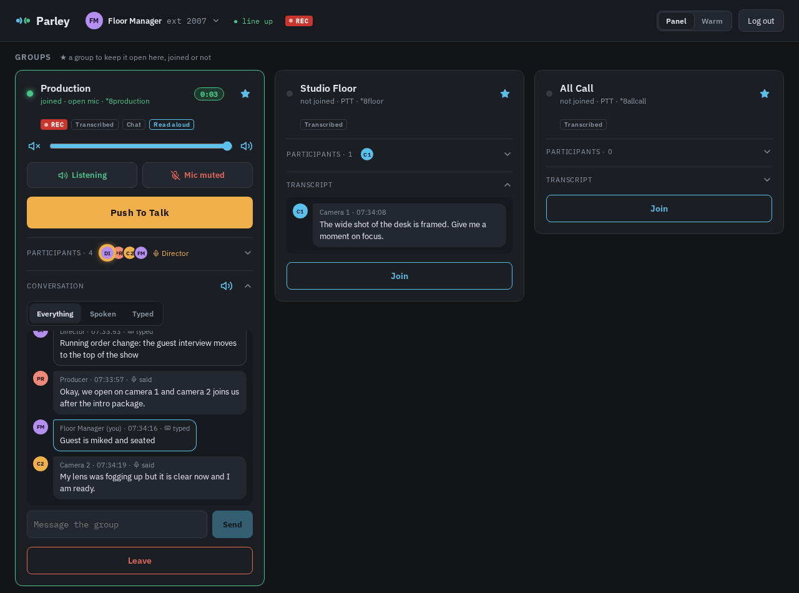

*The Floor Manager (2007) during a countdown: Production is joined and
recorded, the Director is talking (the ring round the avatar), and the
conversation mixes said and typed lines. Studio Floor and All Call are
starred, so they stay open as full cards without being joined.*

A fuller tour is on the [project overview page](https://github.com/chrisnock-personal/project-overviews/tree/main/parley).

Parley (called Open Intercom until 2026-10-18) continues **ip-intercom**
(`chrisnock-personal/ip-intercom`) in a fresh repo, without its git
history. Trading-turret features (handsets, speaker, external PBX lines)
live in a sister project, **Open Turret** (`chrisnock-personal/open-turret`).

## Contents
- [Features](#features): [talk groups](#talk-groups), [direct intercom](#direct-intercom),
  [conversation](#conversation-transcripts-chat-read-aloud), [recording](#recording-sip-rec),
  [devices and themes](#devices-and-themes), [admin console](#admin-console)
- [Architecture](#architecture)
- [Run it](#run-it-podman-compose), [TLS](#tls), [setting up a client](#setting-up-an-intercom-client)
- [Repo layout](#repo-layout), [notes](#notes--knobs), [roadmap](#roadmap), [license](#license)

## Features

### Talk groups
A group is a party line: everyone in it hears everyone else who's talking.
Groups are **open mic**, **push to talk** or **listen only**. A user can be
in any number at once, and each joined group has its own mic toggle, wide
**Push To Talk** button, listen mute and volume. Muting and PTT happen in the
browser (gating the local mic track), so they take effect at once with no
signalling round trip.

A **listen-only** group is a paging zone. On the group's console page, the
people marked **Talks** can talk (push to talk); everyone else listens. A
listener's client joins by itself, receive-only (no microphone, nothing
sent), while a talker is in the group, and leaves when they've all gone. A
listener who leaves during a page isn't brought back until the next one;
one who joins by hand (**Listen now**) stays until they leave.

- **Who's in it and who's talking**, shown on every group card whether or
  not you've joined (from pbx-core's live call list, polled every second).
  The talking ring ignores music and held tones (a pitch check in the
  transcriber).
- **Favourites**: star a group to keep it as a full card. Cards are joined
  groups, then favourites, then groups opened from a tile; the rest fold
  into tiles under "Other groups".
- **Person card**: click any avatar to see the person's name, extension,
  whether they're online or talking, which of your groups they're in, and
  call them.

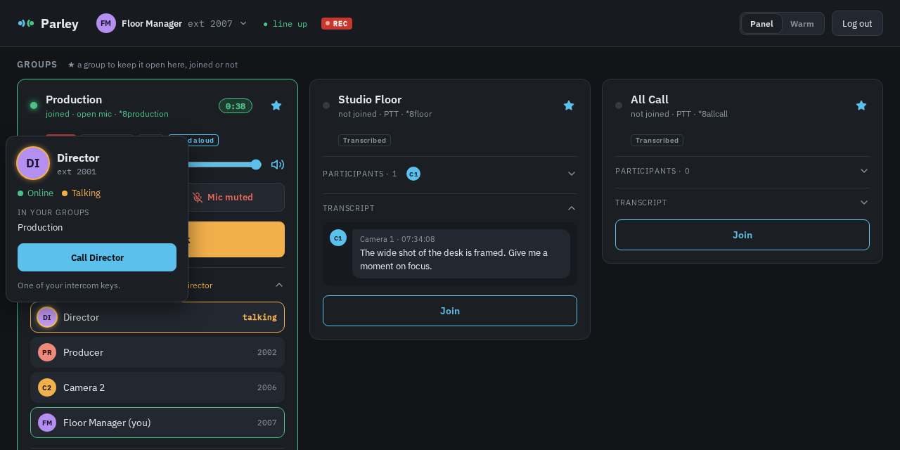

Under the hood a group call (`*8<dial_code>`) is B2BUA'd by pbx-core to
FreeSWITCH, which joins it into a `mod_conference` room of the same name,
used purely as a mixer.

### Direct intercom
The **Intercom** card holds a user's ICM keys, one per person they call
often. Press one and the other side answers by itself (pbx-core adds
`Call-Info: answer-after=0` / `Alert-Info` auto-answer headers), so you're
talking straight away. Either side can **hold and resume** (a real
re-INVITE through rtpengine, not a local mute), and auto-answer can be
switched off per session for a manual Answer/Reject banner.

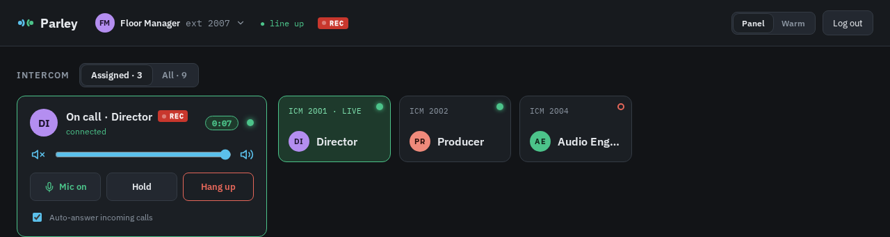

### Conversation: transcripts, chat, read aloud
Switched on per group in the console:
- **Transcribe**: the `transcriber` service taps each member's own voice
  from rtpengine, cuts it into utterances at pauses, sends them to a
  whisper.cpp `whisper-server` (`WHISPER_URL`) and stores each line against
  the speaker, so two people talking over each other are still attributed
  correctly. Silence, muted members and music are never sent.
- **Chat**: members type to the group (1-1000 characters).

With both on, spoken and typed lines share one **Conversation** timeline,
marked *said* or *typed*, with an Everything / Spoken / Typed filter. Anyone
with a button for the group can read it, joined or not, and a *new* badge
marks unread lines. Lines are kept for the retention set under Settings,
then deleted.

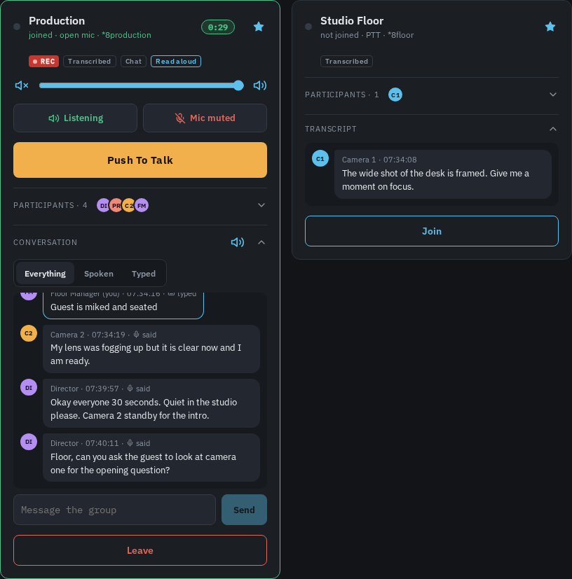

**Read aloud** (per user, per group) speaks a joined group's incoming chat
messages with the browser's own voice: queued so they don't overlap, the
group's audio ducked to 30% while one is read, and held back while you hold
Push To Talk. Voice, speed and volume are per device.

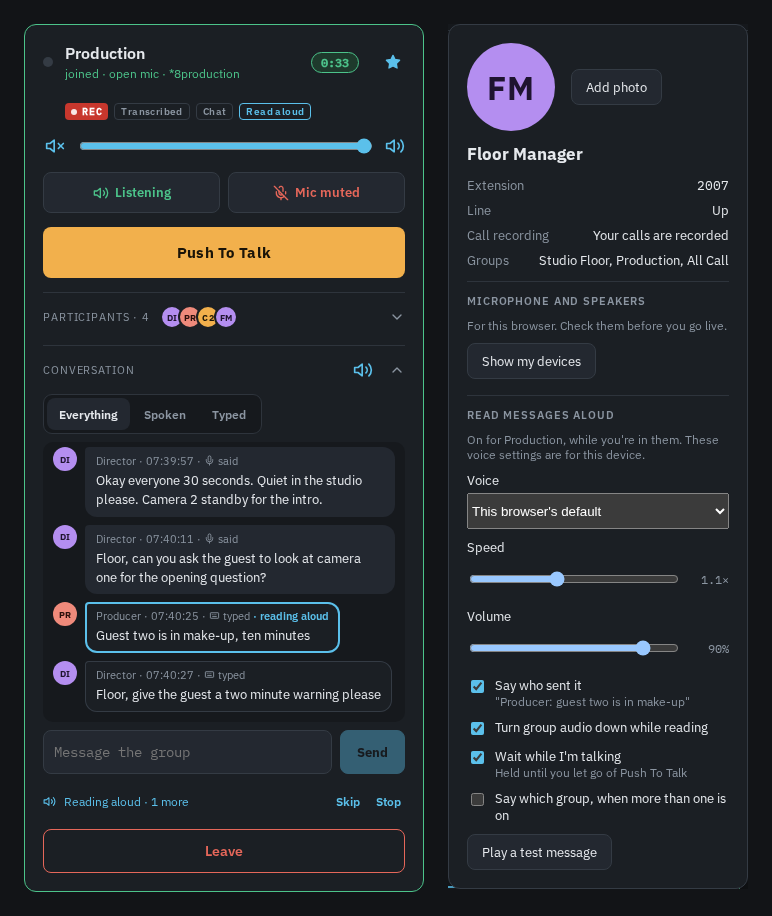

### Recording (SIP-REC)
Turn on **Record calls** for a person and set the recording server URI
under Settings. pbx-core then acts as an RFC 7866 recording client for that
person's direct calls and group legs: it takes a copy of the media from
rtpengine (`subscribe request`, so nothing is added to the audio path),
sends the recorder one labelled stream per party plus RFC 7865 participant
metadata, and ends the session with the call. Recording fails open: if the
recorder can't be reached the call goes ahead unrecorded (logged). A
**REC** tag shows in the client's top bar when your calls are recorded, on
a direct call while it's recorded, and on a group while any member's leg
is.

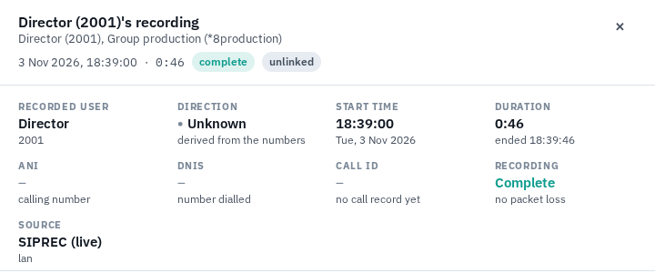

### Devices and themes
The client is a web page served at `/intercom-client/`, so there's nothing
to install, and a user's groups, keys, favourites and read-aloud choices
follow them to whichever device they log in on (a hot-desk login:
extension + password). Two themes: a graphite **Panel** and a warmer
**Warm**. On a phone the cards stack into one column and a group's
conversation opens full screen.

**Microphone and speakers** are chosen per browser in the profile menu,
with a live level bar and a test sound. A change applies at once, to calls
already up as well (the microphone is swapped without renegotiating). If the
chosen microphone is unplugged, calls use the default. Safari on iPad and
iPhone can't choose an output from a web page, so there the menu points to
Control Centre instead.

<p>
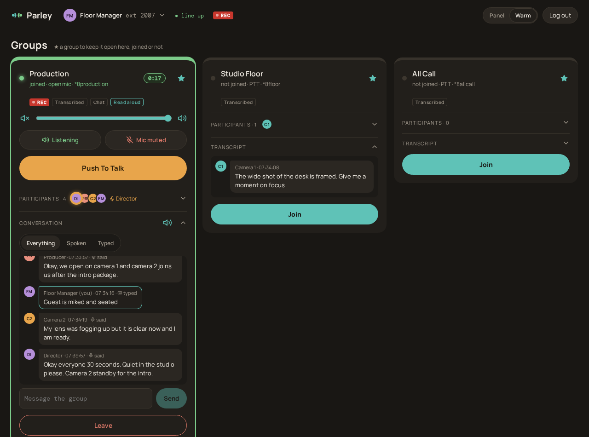
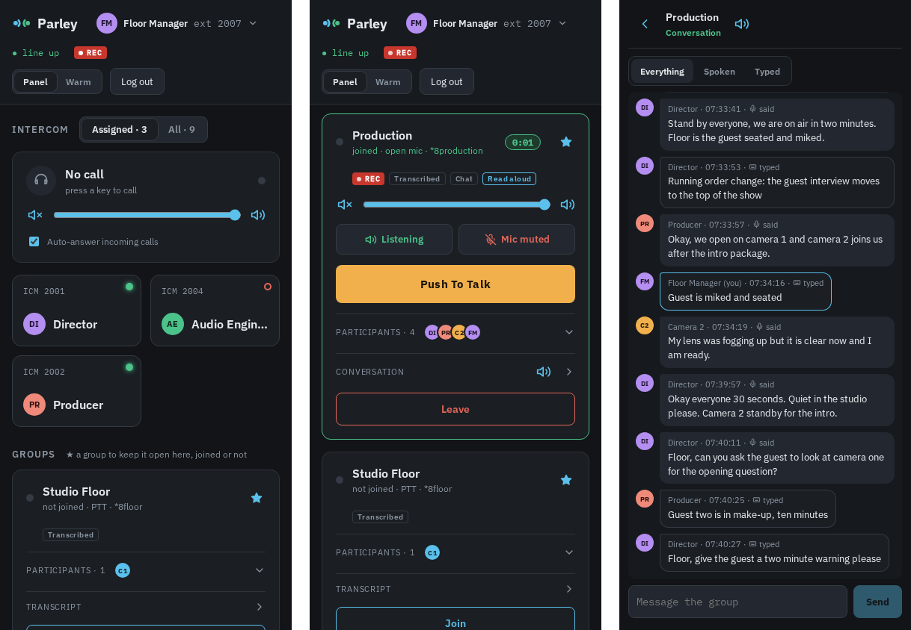
</p>

### Admin console
A separate console at `/` with a sidebar: **Live**, **People**, **Groups**,
and for admins **Settings**, **Health**, **Audit** and **Backups**. Console
users are viewers, editors or admins (JWT roles); actions a role can't take
are greyed out with the reason.

- **Live**: who's online, each group in use with who's in it and who's
  talking, direct calls, and what's being recorded, straight from
  pbx-core's in-memory state (pbx-core's admin `/status`, enriched with
  names by the controller).
- **People**: everyone with a client login. Name, extension, login on/off,
  Record calls (admin only), their groups and ICM keys, password reset.
- **Groups**: talk mode, Transcribe and Chat, who has the group (give it to
  several people in one place) and who's in it now.
- **Settings**: the SIP-REC recording server, and how long transcripts and
  chat are kept.
- **Health**: host CPU/memory/disk, database size and table sizes,
  pbx-core reachability, and each container's logs (over the podman API
  socket; see below).
- **Audit**: a plain-language history ("Floor Manager: record calls turned
  on") filtered by time, person, kind and subject, exportable as CSV.
- **Backups**: `pg_dump` download and restore, `VACUUM ANALYZE`, purge and
  gzip archive (local or SCP) of old audit and session rows.

<p>
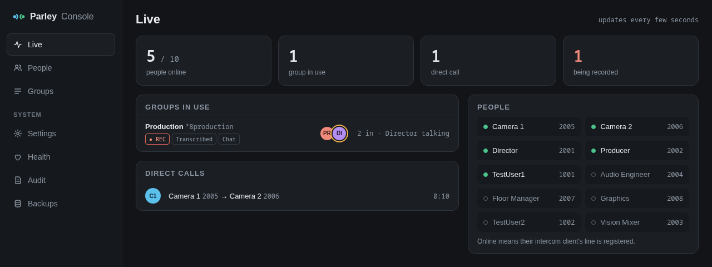
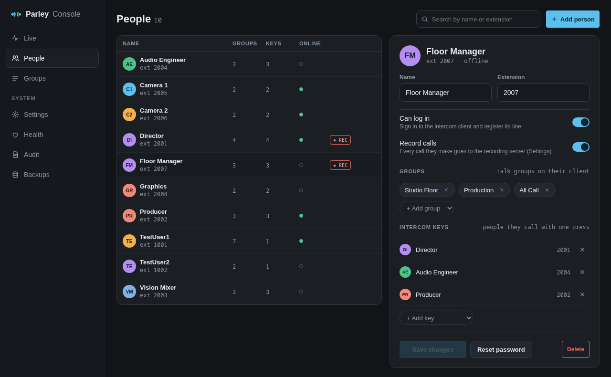
</p>
<p>
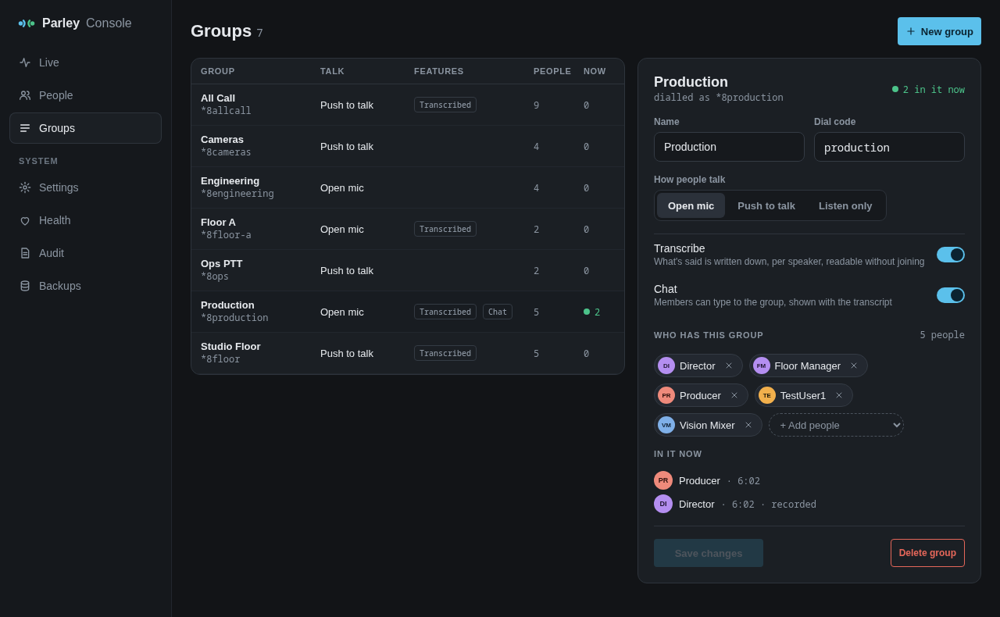
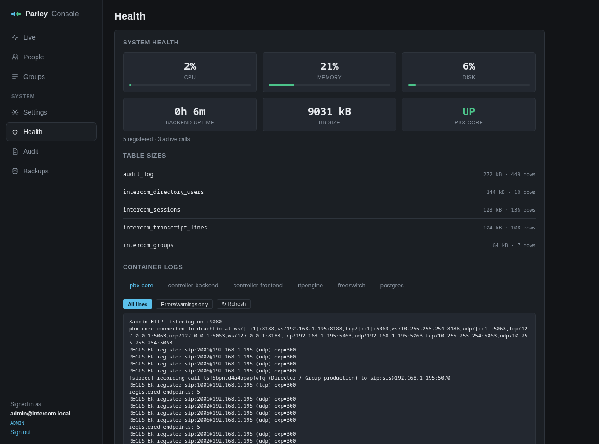
</p>

The screenshots come from the demo crew (see [Demo data](#demo-data)),
with four scripted crew members talking and recording going to CallNest,
a SIP-REC recorder from another of my projects.

## Architecture
```
intercom-client (browser: getUserMedia/RTCPeerConnection, wss:// via nginx /ws)
      │ SIP/WS (WebRTC media, DTLS-SRTP)
      ▼
   pbx-core (drachtio + TS)  ◀─ ng ─▶  rtpengine (media anchor; DTLS-SRTP ↔ plain RTP)
      │ group calls (*8<code>) B2BUA'd to ▼              │ subscribe (copies of media)
   freeswitch (mod_conference open-mic mixer)            ├─▶ transcriber ─▶ whisper-server
                                                         └─▶ SIP-REC recorder (via pbx-core)
controller-frontend (nginx: console + /intercom-client/ + /ws proxy, HTTP+HTTPS)
                                                  ──/api/v1──▶ controller-backend
                                                                (Express+TS, Postgres)
```

Seven compose services: `postgres`, `controller-backend`,
`controller-frontend` (also serves the intercom client at
`/intercom-client/`), `pbx-core`, `rtpengine`, `freeswitch`, `transcriber`.

- **pbx-core is our own SIP code** in TypeScript on drachtio (registrar,
  direct and group routing, re-INVITE handling, SIP-REC), not a
  general-purpose PBX. It authenticates every REGISTER and INVITE with SIP
  digest auth and checks the caller is who the `From` says.
- **rtpengine anchors all media**, so calls work across routed networks
  where devices can't reach each other, and bridges the browsers' WebRTC
  (DTLS-SRTP, ICE-lite) to plain RTP for FreeSWITCH, including two WebRTC
  legs bridged to each other.
- **The client is a genuine WebRTC endpoint** (real `getUserMedia`/
  `RTCPeerConnection`), laid out after Eyevinn's open intercom
  ([intercom-frontend](https://github.com/Eyevinn/intercom-frontend)): one
  direct-intercom slot plus any number of joined groups on one JsSIP UA.
- Controller conventions (`pg` pool, numbered migrations, JWT roles,
  append-only `audit_log`, background health polling) follow the author's
  Walk the Nxt Floor project.

### Media images are built locally, not pulled
Both media components are built from Dockerfiles under `images/` rather
than pulled as pre-built images, because the obvious public images don't
work: SignalWire's FreeSWITCH image is behind an auth-gated registry, and
the only `:latest` rtpengine on Docker Hub is ~5 years old.

- **`images/rtpengine`** installs `rtpengine-daemon` from the Debian
  bookworm package and runs it **userspace-only** (`--table=-1`) so it
  needs no kernel module in the container.
- **`images/freeswitch`** builds `FROM drachtio/drachtio-freeswitch-base`,
  overlaying a minimal `modules.conf`, a `sofia.conf` including our SIP
  profile, the intercom SIP profile + dialplan, and an open-mic conference
  profile. The profile's bind IP is set explicitly via `FREESWITCH_BIND_IP`
  (see `entrypoint.sh`) rather than FreeSWITCH's own `$${local_ip_v4}`
  auto-detection -on a multi-homed host, that auto-detection can pick a
  different interface than the one pbx-core is configured to dial, which
  silently breaks every group call.

## Run it (podman-compose)
```bash
cp .env.example .env
# edit .env: set RTPENGINE_PUBLIC_IP to this host's routed/LAN IP, and
# fill in JWT_SECRET, ADMIN_PASSWORD, PGPASSWORD, DRACHTIO_SECRET and
# INTERNAL_API_TOKEN (`openssl rand -hex 24` each). There are no defaults:
# the stack refuses to start without them.

podman-compose up -d --build
```
- Controller UI: `https://<host>:8445` (plain `http://<host>:8080` serves
  `localhost` only and redirects everyone else to HTTPS) -sign in
  with `ADMIN_EMAIL` / `ADMIN_PASSWORD` from `.env`. (Host `8445`, not the
  usual `8443` -see `docker-compose.yml`'s comment: `8443`/`8444` collide
  with other projects on the reference lab host.)
- Intercom Client: `http://localhost:8080/intercom-client/` (`getUserMedia`
  needs a secure context, and `localhost` is browser-exempted) or `https://<host>:8445/intercom-client/` (works from a
  genuinely separate machine too, once you click through the self-signed
  cert warning once per browser -see "TLS" below).
- Controller API: `https://<host>:8445/api/v1/...` through nginx. The
  backend's own `:3100` is bound to `127.0.0.1` only.
- pbx-core SIP/WS: `<host>:8188`, SIP UDP/TCP on `:5063` (neither is the
  standard `:8088`/`:5060` -see `pbx-core/entrypoint.sh`'s comment: this
  host also runs another SIP stack, `asterisk-ci`, that already holds both).
- Postgres: `127.0.0.1:5433` on the host, for direct inspection.
- Internal only: drachtio's control port `127.0.0.1:9022`; pbx-core's
  `/status` (`:9080`) and the transcriber's `/talking`/`/poke` (`:9081`)
  need `Authorization: Bearer $INTERNAL_API_TOKEN`; FreeSWITCH's `:5080`
  accepts INVITEs only from this host's own address (ACL `pbx_core`).

`pbx-core`, `rtpengine`, and `freeswitch` run with `network_mode: host` —
required so rtpengine can anchor media reachably for endpoints on other
subnets in a routed deployment.

### Demo data
Set `SEED_DEMO=true` in `.env` before `podman-compose up` to get a
ready-to-use demo: a broadcast control-room crew on extensions **2001-2008**
(Director, Producer, Vision Mixer, Audio Engineer, Camera 1/2, Floor
Manager, Graphics), all with password `DEMO_PASSWORD` (default
`demo1234`). There are five talk groups: Production and Engineering (open
mic), and Cameras, Studio Floor and All Call (PTT). Each crew member gets
ICM keys to the people they'd talk to and buttons for their groups.
Seeding is additive and idempotent: existing extensions and group dial
codes are never touched, so it's safe to leave on. Production is created with
live transcription on, so the demo shows it straight away.

### Optional: the Health page's log viewer
The console's Health page can show live logs from every container over the
podman API socket. This needs one host-level prerequisite (rootless
podman):
```bash
systemctl --user enable --now podman.socket
```
On SELinux-enforcing hosts (Fedora/RHEL), `controller-backend` also runs
with `security_opt: label:disable` in `docker-compose.yml` -SELinux
denies a confined container from connecting to the podman socket even with
the file permissions otherwise correct, and no stock boolean covers that
specific case. This widens that one container's blast radius (full
control-plane visibility into every container on the host, not just this
project's 6) -accepted deliberately for this lab; skip the log viewer
entirely if you'd rather not take that tradeoff.

### TLS
`controller-frontend` creates a small **local CA** on first start, and that
CA signs the server certificate nginx presents. Both are kept in a volume,
so they survive redeploys. HTTPS is on `:8445` (see `docker-compose.yml`).
Plain HTTP (`:8080`) serves `localhost` and `/ca.crt` only; any other visit
redirects to HTTPS, so passwords never cross the LAN in clear text and the
browser allows the microphone (it needs a secure context).
Nothing else needs configuring beyond `RTPENGINE_PUBLIC_IP` in `.env`, which
is used as the certificate's IP entry. The client's SIP/WS signaling is
proxied through the same nginx at `/ws`.

**Trust the CA on each device** (once per device):
- **iPad / iPhone**: open `http://<host>:8080/ca.crt` in Safari and allow
  the profile download. Install it in Settings → *Profile Downloaded*, then
  turn it on under Settings → General → About → *Certificate Trust
  Settings*. Tapping through Safari's certificate warning is **not
  enough**: WebKit doesn't extend that exception to WebSocket connections,
  so the client's SIP line never connects ("connecting…" forever).
- **Desktop browsers**: import `ca.crt` as a trusted authority, or click
  through the warning (desktop Chrome/Firefox do allow the WebSocket after
  that).

The CA has **no** name constraints: iOS rejected a name-constrained version
(see `controller/frontend/entrypoint.sh`). Its private key never leaves the
`parley-tls-certs` volume, but anyone holding that key could mint
certificates that trusting devices would accept for any site, so protect
the volume, and remove the profile from devices you no longer use. The server certificate follows Apple's rules (825-day validity,
server-auth usage) and is re-issued automatically within 30 days of expiry.
If `RTPENGINE_PUBLIC_IP` changes, a new CA is generated and every device
must install it again.

### Setting up an intercom client
1. Console → **People** → add a person (name, extension, client login
   password), then give them groups and ICM keys (the people they can call
   with one press).
2. Open `https://<host>:8445/intercom-client/` (or
   `http://localhost:8080/intercom-client/` on the host itself), log in with the extension
   + password.
3. Press an ICM key -direct calls auto-connect instantly (pbx-core's
   auto-answer headers) on the Intercom panel; press the same key again to
   hang up. Press **Join** on a group to enter its FreeSWITCH
   conference; join as many groups as you like, and **Leave** each one
   separately. A group with `ptt_default` set starts muted: hold
   **Hold to talk**, or click the mute toggle to latch the mic open.
4. Testing two intercom clients on **one machine**: use genuinely separate
   browser contexts (an Incognito window, or a different browser)
   -duplicated tabs share `sessionStorage` and will fight over the same
   login.

### Testing a group (open-mic)
1. Console → **Groups** → add a group (talk mode *Open mic*, *Push to
   talk* or *Listen only*; for listen only, mark who **Talks** once people
   have it). The dial code defaults to a slug of the name. Tick
   *Transcribe* and/or *Chat* if wanted.
2. Give it to people, either on the group's own page or on each person's
   page under **People**.
3. Have a client press **Join** on the group: pbx-core routes
   `*8<dial_code>` to FreeSWITCH, which joins every talking member into the
   same conference. Everyone unmuted hears everyone else.

## Repo layout
```
docker-compose.yml          -full stack (this is what you run)
.env.example                -copy to .env and fill in
pod.yaml                    -alternative: podman play kube (pbx-core+rtpengine only)
migrations/                 -controller's numbered SQL migrations
controller/
  backend/                  -Express API: auth, endpoints, groups, intercom,
                               directory users, intercom client login, system
                               health/audit/logs, admin db backup/restore
  frontend/                 -console (Vite/React, built + served by nginx) —
                               its Containerfile also builds intercom-client/
                               as a second stage, served at /intercom-client/;
                               entrypoint.sh generates a self-signed TLS
                               cert on first start
intercom-client/            -real-browser intercom client (Vite/React/TS):
                               genuine getUserMedia/RTCPeerConnection, an
                               Intercom (direct) slot + N groups,     
                               directory-user login
pbx-core/                   -drachtio SIP core: registrar, direct/group
                               routing, rtpengine wrapper, admin status API
images/
  rtpengine/                -rtpengine media relay image (Debian package, userspace mode)
  freeswitch/                -group open-mic mixer image (FROM drachtio FS base + conf overlay)
patches/
  endpoint-auto-answer.md   -reference notes for the separate, unrelated
                               container-sip-endpoint sibling project
```

## Notes / knobs
- **SIP digest auth is on** for pbx-core's REGISTER/INVITE (RFC 2617/3261) —
  each directory user's intercom-client login password doubles as their SIP
  credential (pbx-core stores/checks a precomputed HA1 hash of it, never the
  plaintext -see `migrations/011_directory_user_sip_auth.sql`). A directory
  user created or password-reset before this migration, or whose extension
  was changed since, needs a password reset (People -> **Reset password**) before they can register again.
- **Endpoint REST API tokens**: `controller-backend` sends `Authorization:
  Bearer <token>` on every call to an endpoint's `rest_url` when one is set
  (`POST /endpoints/:id/regenerate-token`, admin-only, returns the token
  once -no other route ever exposes it again). Optional, not required: an
  endpoint with no token configured gets no `Authorization` header at all.
  Whether this is actually enforced depends entirely on that endpoint's own
  implementation -nothing built into this repo runs a real endpoint today
  (`intercom_endpoints` is empty by design; `intercom-client` doesn't use
  this REST path at all, it dials pbx-core directly over SIP).
  Still unauthenticated: FreeSWITCH's own `intercom` SIP profile (the
  pbx-core-to-FreeSWITCH leg, internal-only) -add FreeSWITCH auth before
  this leaves the lab.
- TLS is self-signed (see "TLS" above) -fine for a private LAN lab, but
  every browser/device needs its own one-time trust exception. Swap in a
  real cert by mounting it over `/etc/nginx/tls/{cert,key}.pem` if you
  ever have one (e.g. an internal CA).
- `HEALTH_INTERVAL_MS` / retention are env-configurable on
  `controller-backend`, same pattern as Walk the Nxt Floor's
  `sipHealthService`.
- Local dev without containers: `cd controller/backend && npm install &&
  npm run dev` needs `PGHOST`/`PGPORT` etc pointed at a reachable Postgres;
  note `migrate.ts`'s `MIGRATIONS_DIR` assumes the container layout —
  adjust the relative path if running straight from `src/`.

## Roadmap
Planned work, open questions and known bugs are tracked in
[GitHub issues](https://github.com/chrisnock-personal/parley/issues).

## License

MIT. See [LICENSE](LICENSE). The container images it builds pull in
third-party software under its own licences (FreeSWITCH, rtpengine,
drachtio, PostgreSQL, nginx and others).
